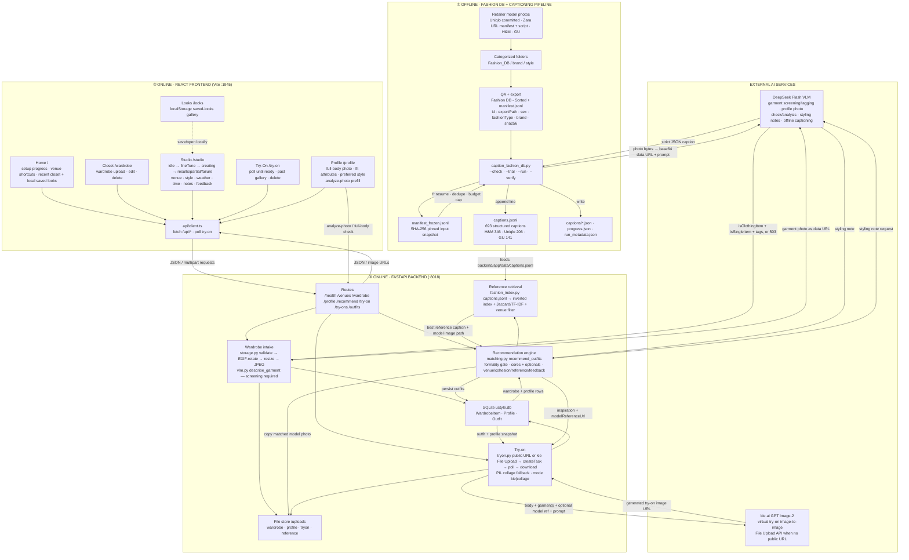

# USTyle — System Flowchart

End-to-end logic flow of the USTyle AI outfit assistant: how images and user
input become structured data, and how that data is transformed into outfit
recommendations and try-on images.

The tagged `run_metadata.json` is the completion record of the **offline
captioning pipeline** (box ①), whose output (`captions.jsonl`) powers the
recommendation engine (box ③).

## What USTyle aims to help HKUST students with

USTyle is a **single-user AI outfit assistant for HKUST students** (COMP1945,
Group 18). It targets one very specific campus problem: **"what do I wear
today, for this event, from the clothes I actually own?"** HKUST students
regularly move between events with very different — and often unwritten — dress
codes: lectures, career fairs, hall gatherings, casual dates and formal
dinners. USTyle removes that daily decision by:

- **Knowing your closet** — you upload photos of the clothes you own and the
  system screens each one (is it really a single garment?) and tags it
  (category, colour, cut, style, formality, gender fit). Screening **requires**
  DeepSeek Flash; a missing key or a failed call rejects the photo (HTTP 503)
  instead of guessing.
- **Matching the occasion** — you pick a venue (and optionally style, weather,
  time of day, and free-text notes) and it assembles 2–3 outfits from your own
  wardrobe, scored for venue fit, cohesion, formality range, and similarity to
  real fashion-DB looks. Optional outerwear and accessories are attached when
  they improve the look.
- **Showing the result** — a virtual try-on of *you* wearing the chosen
  outfit, so you can preview it before committing. kie.ai is used when
  configured; otherwise a labeled PIL collage is shown.

It is a **campus demo / proof-of-concept**: one user, one wardrobe, no
authentication.

## The tabs and how they interact

USTyle is a single-page app with six tabs in the left sidebar (see
`frontend/src/components/Layout.tsx`). Each tab owns one job and hands data to
the next tab through the shared FastAPI backend + SQLite database — the tabs
never talk to each other directly. Activity and Alerts are no longer sidebar
pages; they remain in-memory/localStorage helpers used by Studio recovery.

| Tab | Route | Owns | Feeds into |
|---|---|---|---|
| **Home** | `/` | Setup checklist, venue shortcuts, recent closet + saved looks | Closet, Studio, Profile |
| **Closet** | `/wardrobe` | Upload / edit / delete wardrobe items | Studio (outfit source) |
| **Studio** | `/studio` | Venue + style + weather/time + notes → outfit recommendations | Looks, Try-On |
| **Try-On** | `/try-on` | Virtual try-on of a recommended outfit; past try-on gallery | Looks |
| **Looks** | `/looks` | Saved-outfit gallery (browser localStorage) | Studio |
| **Profile** | `/profile` | Body photo, height/weight, gender, skin tone, preferred style | Studio, Try-On |

Legacy redirects: `/dress-me` → `/studio`, `/settings` and `/you` → `/profile`.

Data flows between tabs:

1. **Closet → Studio.** The `WardrobeItem` rows created in Closet are the only
   ingredient `matching.recommend_outfits()` uses. Studio cannot run until the
   closet has at least one top, one bottom and one pair of shoes (Create is
   disabled; `POST /api/recommend` returns 400 otherwise).
2. **Profile → Studio.** The stored `preferred_style` is used as the default
   style whenever Studio runs without an explicit style override.
3. **Profile → Try-On.** The body photo is required. Height/weight, gender and
   skin tone are baked into the try-on prompt sent to kie.ai. Choosing a photo
   first calls `POST /api/profile/analyze-photo` to pre-fill gender and a hex
   skin tone.
4. **Studio → Looks.** "Save look" writes a gallery entry to localStorage
   (`ustyle.savedLooks.v1`). Recommend also persists `Outfit` rows in SQLite
   so try-on and `GET /api/outfits` can find them; the Looks tab itself does
   not read that API.
5. **Studio → Try-On.** A result card can send the chosen outfit (and venue)
   straight to the Try-On tab via the Studio session store.
6. **Try-On → Looks.** A finished try-on can be saved as a look. Past try-ons
   come from `GET /api/try-ons` (newest first, files that no longer exist are
   skipped) and can be deleted with `DELETE /api/try-ons/{outfitId}` after two
   confirmations.
7. **Home → everywhere.** Home reads wardrobe/profile state to render a setup
   checklist (at least 2 items, full-body photo, height + preferred style) and
   deep-links into Closet, Studio (venue shortcuts) and saved looks.

## User walkthrough

A first-time student goes through this loop:

1. **Open Home.** The setup checklist shows what is missing: at least 2
   wardrobe items, a full-body photo, and height + preferred style.
2. **Fill in Profile.** Upload a full-body photo (face visible) and enter
   height, weight, gender, skin tone and preferred style. The photo is
   AI-checked (full-body? face visible?) before it is saved. Gender and skin
   tone can be pre-filled from the photo.
3. **Build the Closet.** Upload photos of their own clothes one by one. Each
   photo is screened ("is it one standalone garment?") and tagged by DeepSeek
   Flash, then saved as a `WardrobeItem`; invalid photos are rejected with a
   reason. Studio additionally needs one top, one bottom and one pair of shoes
   before Create is enabled.
4. **Run Studio.** Pick a venue (lecture, career fair, casual date, hall
   gathering, formal) and optionally a style, weather, time of day and
   free-text notes, then run. The backend keeps core garments inside the
   venue's formality range, builds top×bottom cores with mandatory shoes and
   optional outerwear/accessories, scores venue-fit + cohesion + word-semantic
   reference similarity + feedback/context, and returns 2–3 ranked outfits. If
   nothing in-range exists, it returns `matchStatus: "fallback"` alternatives.
5. **Save or refine.** Fine-tune with feedback ("too formal", "change the
   shoes", …) and re-run, or save the look locally.
6. **Generate the Try-On.** Pick a recommended outfit (body photo required).
   kie.ai receives the body photo, garment photos, and (when present) the
   matched model photo plus styling note; if kie.ai is unavailable it falls
   back to a PIL collage.
7. **Manage Looks.** Browse, download or delete saved looks — and tap a look to
   reopen it in Studio for the same venue.

## How data is transformed along the way

| Stage | Input | Transformation | Output / sink |
|-------|-------|----------------|---------------|
| ① Image sourcing | Retailer pages / URL manifest | Download + categorize by style folder | `Fashion_DB/{brand}/{style}/*.jpg` |
| ① QA + export | Categorized images | Integrity check, manifest generation | `Fashion DB - Sorted/` + `manifest.jsonl` |
| ① Captioning | Model photo | `caption_fashion_db.py` base64-encodes the image and sends it to DeepSeek Flash with a strict JSON prompt | one caption line in `captions.jsonl` |
| ① Caption record | VLM JSON | Normalized schema: `descriptionObserved`, `garments[]`, `styleSuggestionsInferred`, `searchTextObserved`, `uncertainties` | `captions/*.json` + `progress.json` + `run_metadata.json` |
| ③ Wardrobe upload | User photo (JPEG/PNG/WebP) | `storage.py` validates, EXIF-rotates, resizes, re-encodes to JPEG; `vlm.py` **must** screen via DeepSeek (`isClothingItem` + `isSingleItem`); rejected or unverified photos are deleted | `/uploads/wardrobe/*.jpg` + `WardrobeItem` row, or HTTP 400/503 |
| ③ Profile | Full-body photo (face visible) + form fields | Optional `POST /api/profile/analyze-photo` pre-fills gender + hex skin tone; `PUT /api/profile` AI-checks full-body/face, then saves | `/uploads/profile/*.jpg` + `Profile` row |
| ③ Recommend | `{venue, preferredStyle?, feedback?, weather?, timeOfDay?, dressCode?, notes?}` + wardrobe rows | Filter core garments by venue formality; sample top×bottom cores; attach shoes + optional outerwear/accessory; score venue-fit / cohesion / reference-similarity / feedback / context; diversify; optional DeepSeek styling note | 2–3 `Outfit` JSONs + `Outfit` rows; `matchStatus` `matched` or `fallback` |
| ③ Reference retrieval | Outfit text tokens | `fashion_index.py` TF-IDF/Jaccard over `captions.jsonl`, venue-weighted | best reference caption + `/uploads/reference/` model image |
| ③ Try-on | Body photo + outfit garments + profile attributes + optional inspiration / model reference | `tryon.py` builds a prompt; uses public image URLs when `PUBLIC_BASE_URL` is reachable, otherwise uploads local files to kie.ai's File Upload API; polls and downloads; falls back to a PIL collage | `/uploads/tryon/*.jpg` with `mode: kie` or `collage` |

## Notes

- `fashion_db_index.json` is a legacy indexer artifact (`scripts/index_fashion_db.py`);
  the live retrieval path is `captions.jsonl` → `fashion_index.py`, with
  `reference_outfits.json` as the no-captions fallback. The live caption file
  is H&M + Uniqlo + GU (693 rows). Zara photos exist in `Fashion_DB/` but are
  not in `captions.jsonl`.
- Wardrobe uploads do **not** degrade to filename/color heuristics. No DeepSeek
  key or a failed screen → HTTP 503, photo deleted. Heuristics only fill
  missing tag fields after a successful screen.
- Profile full-body checking is skipped (upload allowed) if DeepSeek is missing;
  profile photo analysis falls back to a local skin-tone heuristic.
- Try-on still works without a public tunnel: local `/uploads/...` files are
  uploaded to kie.ai first. No `KIE_API_KEY`, fewer than two usable images, or
  a kie.ai failure → PIL collage (`mode: collage`).
- Looks are a client-side gallery. Recommend persistence in SQLite is for
  try-on and `GET /api/outfits`, not for the Looks tab.
- Evaluation can POST `useReference: false` to skip the fashion-DB boost,
  inspiration text, model photo, and DeepSeek styling note.
