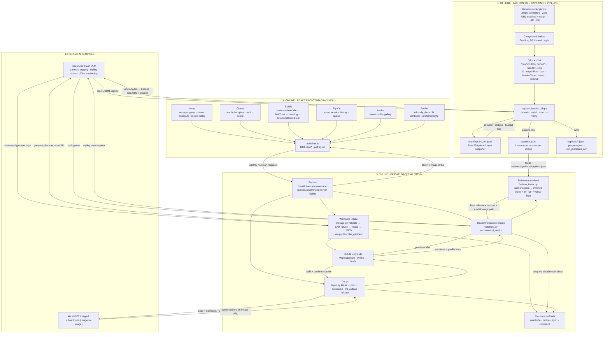

# USTyle — System Flowchart

End-to-end logic flow of the USTyle AI outfit assistant: how images and user
input become structured data, and how that data is transformed into outfit
recommendations and try-on images.

The tagged `run_metadata.json` is the completion record of the **offline
captioning pipeline** (box ①), whose output (`captions.jsonl`) powers the
recommendation engine (box ③).

## What USTyle aims to help HKUST students with

USTyle is a **single-user AI outfit assistant for HKUST students** (COMP1945,
Group 18). It targets one very specific campus problem: **"what do I wear
today, for this event, from the clothes I actually own?"** HKUST students
regularly move between events with very different — and often unwritten — dress
codes: lectures, career fairs, hall gatherings, casual dates and formal
dinners. USTyle removes that daily decision by:

- **Knowing your closet** — you upload photos of the clothes you own and the
  system screens each one (is it really a single garment?) and tags it
  (category, colour, cut, style, formality, gender fit).
- **Matching the occasion** — you pick a venue and it assembles 2–3 outfits
  from your own wardrobe, scored for venue fit, cohesion and similarity to
  real fashion-DB looks.
- **Showing the result** — a virtual try-on of *you* wearing the chosen
  outfit, so you can preview it before committing.

It is a **campus demo / proof-of-concept**: one user, one wardrobe, no
authentication. Everything degrades gracefully if an AI service is missing.

## The tabs and how they interact

USTyle is a single-page app with six tabs in the left sidebar (see
`frontend/src/components/Layout.tsx`). Each tab owns one job and hands data to
the next tab through the shared FastAPI backend + SQLite database — the tabs
never talk to each other directly.

| Tab | Route | Owns | Feeds into |
|---|---|---|---|
| **Home** | `/` | Setup checklist, venue shortcuts, recent saved looks | Closet, Studio, Looks |
| **Closet** | `/wardrobe` | Upload / edit / delete wardrobe items | Studio (outfit source) |
| **Studio** | `/studio` | Venue + style + context → outfit recommendations | Looks, Try-On |
| **Try-On** | `/try-on` | Virtual try-on of a saved outfit | Looks |
| **Looks** | `/looks` | Saved-outfit gallery, download / delete / re-run | Studio |
| **Profile** | `/profile` | Body photo, height/weight, gender, skin tone, preferred style | Studio, Try-On |

Data flows between tabs:

1. **Closet → Studio.** The `WardrobeItem` rows created in Closet are the only
   ingredient `matching.recommend_outfits()` uses. Studio cannot run until the
   closet has at least one top, one bottom and one pair of shoes.
2. **Profile → Studio.** The stored `preferred_style` is used as the default
   style whenever Studio runs without an explicit style override.
3. **Profile → Try-On.** The body photo, height/weight, gender and skin tone
   are baked into the try-on prompt sent to kie.ai.
4. **Studio → Looks.** Every successful run persists `Outfit` rows; the Looks
   tab lists the most recent saved looks.
5. **Studio → Try-On.** A result card can send the chosen outfit straight to
   the Try-On tab.
6. **Try-On → Looks.** A finished try-on can be saved as a look.
7. **Home → everywhere.** Home reads wardrobe/profile state to render a setup
   checklist and deep-links into Closet ("start your closet"), Studio (venue
   shortcuts) and Looks (recent looks).

## User walkthrough

A first-time student goes through this loop:

1. **Open Home.** The setup checklist shows what is missing: at least 2
   wardrobe items, a full-body photo, and height + preferred style.
2. **Fill in Profile.** Upload a full-body photo (face visible) and enter
   height, weight, gender, skin tone and preferred style. The photo is
   AI-checked (full-body? face visible?) before it is saved.
3. **Build the Closet.** Upload photos of their own clothes one by one. Each
   photo is screened ("is it one standalone garment?") and tagged by DeepSeek
   Flash, then saved as a `WardrobeItem`; invalid photos are rejected with a
   reason.
4. **Run Studio.** Pick a venue (lecture, career fair, casual date, hall
   gathering, formal) and optionally a style, weather, time of day and
   free-text feedback, then run. The backend scores every candidate
   combination with venue-fit + cohesion + word-semantic reference similarity
   and returns 2–3 ranked outfits with rationale items.
5. **Save or refine.** Fine-tune with feedback ("too formal", "change the
   shoes", …) and re-run, or save the look.
6. **Generate the Try-On.** Pick a saved outfit and generate a virtual try-on
   image. kie.ai returns the image; if unavailable, a PIL collage fallback is
   used.
7. **Manage Looks.** Browse, download or delete saved looks — and tap a look to
   reopen it in Studio for the same venue.

## How data is transformed along the way

| Stage | Input | Transformation | Output / sink |
|-------|-------|----------------|---------------|
| ① Image sourcing | Retailer pages / URL manifest | Download + categorize by style folder | `Fashion_DB/{brand}/{style}/*.jpg` |
| ① QA + export | Categorized images | Integrity check, manifest generation | `Fashion DB - Sorted/` + `manifest.jsonl` |
| ① Captioning | Model photo | `caption_fashion_db.py` base64-encodes the image and sends it to DeepSeek Flash with a strict JSON prompt | one caption line in `captions.jsonl` |
| ① Caption record | VLM JSON | Normalized schema: `descriptionObserved`, `garments[]`, `styleSuggestionsInferred`, `searchTextObserved`, `uncertainties` | `captions/*.json` + `progress.json` + `run_metadata.json` |
| ③ Wardrobe upload | User photo (JPEG/PNG/WebP) | `storage.py` validates, EXIF-rotates, resizes, re-encodes to JPEG; `vlm.py` tags it via DeepSeek (or filename/color heuristics) | `/uploads/wardrobe/*.jpg` + `WardrobeItem` row |
| ③ Profile | Full-body photo (face visible) + form fields | Photo AI-checked (full-body vs half-body, face visibility), then saved | `/uploads/profile/*.jpg` + `Profile` row |
| ③ Recommend | `{venue, preferredStyle?, feedback?, weather?, ...}` + wardrobe rows | `matching.py` groups by category, samples combos, scores venue-fit/cohesion/reference-similarity/feedback/context, ranks and diversifies | 2–3 `Outfit` JSONs + `Outfit` rows |
| ③ Reference retrieval | Outfit text tokens | `fashion_index.py` TF-IDF/Jaccard over `captions.jsonl`, venue-weighted | best reference caption + model image |
| ③ Try-on | Body photo + outfit garments + profile attributes | `tryon.py` builds a prompt and sends public image URLs to kie.ai; polls and downloads; falls back to a PIL collage | `/uploads/tryon/*.jpg` (shown in the UI) |

## Notes

- `fashion_db_index.json` is a legacy indexer artifact (`scripts/index_fashion_db.py`);
  the live retrieval path is `captions.jsonl` → `fashion_index.py`, with
  `reference_outfits.json` as the no-captions fallback.
- The pipeline degrades gracefully: no DeepSeek key → local heuristics; no kie.ai
  key or no public base URL → PIL collage; missing captions → seeded reference outfits.
