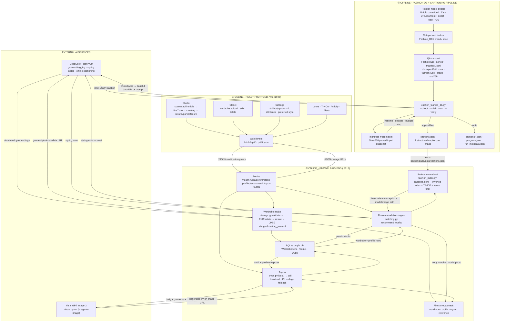

# USTyle — System Flowchart

End-to-end logic flow of the USTyle AI outfit assistant: how images and user
input become structured data, and how that data is transformed into outfit
recommendations and try-on images.

The tagged `run_metadata.json` is the completion record of the **offline
captioning pipeline** (box ①), whose output (`captions.jsonl`) powers the
recommendation engine (box ③).

## How data is transformed along the way

| Stage | Input | Transformation | Output / sink |
|-------|-------|----------------|---------------|
| ① Image sourcing | Retailer pages / URL manifest | Download + categorize by style folder | `Fashion_DB/{brand}/{style}/*.jpg` |
| ① QA + export | Categorized images | Integrity check, manifest generation | `Fashion DB - Sorted/` + `manifest.jsonl` |
| ① Captioning | Model photo | `caption_fashion_db.py` base64-encodes the image and sends it to DeepSeek Flash with a strict JSON prompt | one caption line in `captions.jsonl` |
| ① Caption record | VLM JSON | Normalized schema: `descriptionObserved`, `garments[]`, `styleSuggestionsInferred`, `searchTextObserved`, `uncertainties` | `captions/*.json` + `progress.json` + `run_metadata.json` |
| ③ Wardrobe upload | User photo (JPEG/PNG/WebP) | `storage.py` validates, EXIF-rotates, resizes, re-encodes to JPEG; `vlm.py` tags it via DeepSeek (or filename/color heuristics) | `/uploads/wardrobe/*.jpg` + `WardrobeItem` row |
| ③ Profile | Full-body photo (face visible) + form fields | Photo AI-checked (full-body vs half-body, face visibility), then saved | `/uploads/profile/*.jpg` + `Profile` row |
| ③ Recommend | `{venue, preferredStyle?, feedback?, weather?, ...}` + wardrobe rows | `matching.py` groups by category, samples combos, scores venue-fit/cohesion/reference-similarity/feedback/context, ranks and diversifies | 2–3 `Outfit` JSONs + `Outfit` rows |
| ③ Reference retrieval | Outfit text tokens | `fashion_index.py` TF-IDF/Jaccard over `captions.jsonl`, venue-weighted | best reference caption + model image |
| ③ Try-on | Body photo + outfit garments + profile attributes | `tryon.py` builds a prompt and sends public image URLs to kie.ai; polls and downloads; falls back to a PIL collage | `/uploads/tryon/*.jpg` (shown in the UI) |

## Notes

- `fashion_db_index.json` is a legacy indexer artifact (`scripts/index_fashion_db.py`);
  the live retrieval path is `captions.jsonl` → `fashion_index.py`, with
  `reference_outfits.json` as the no-captions fallback.
- The pipeline degrades gracefully: no DeepSeek key → local heuristics; no kie.ai
  key or no public base URL → PIL collage; missing captions → seeded reference outfits.
